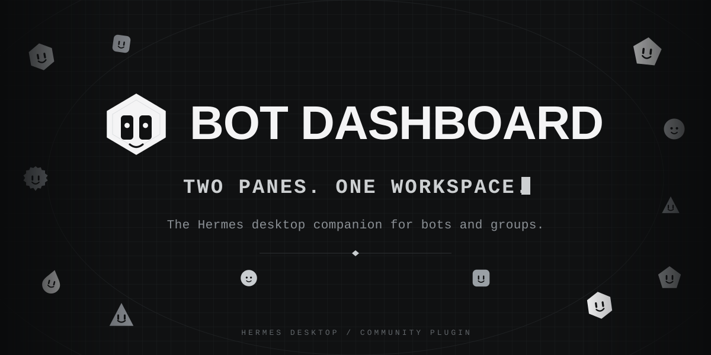
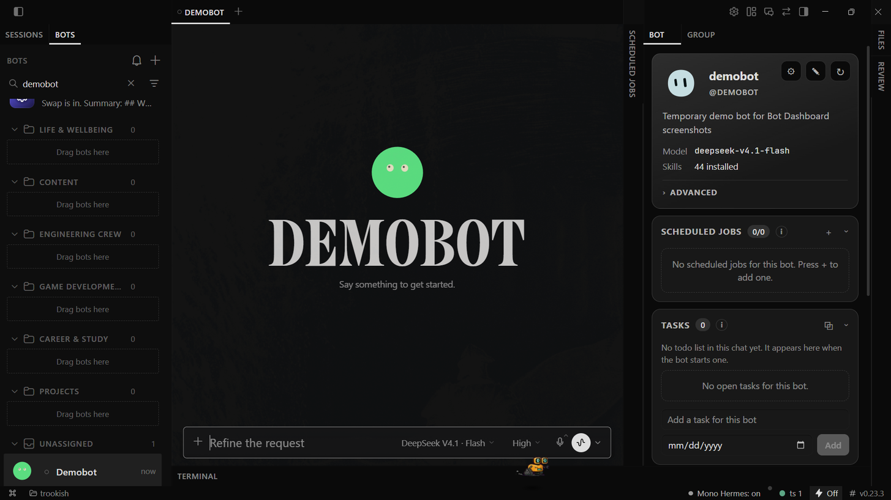
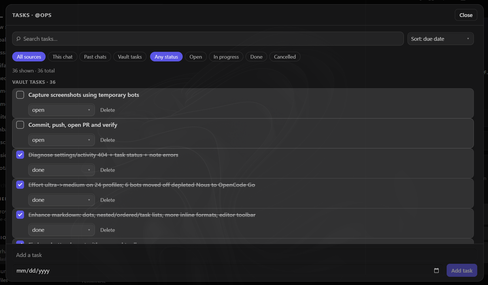
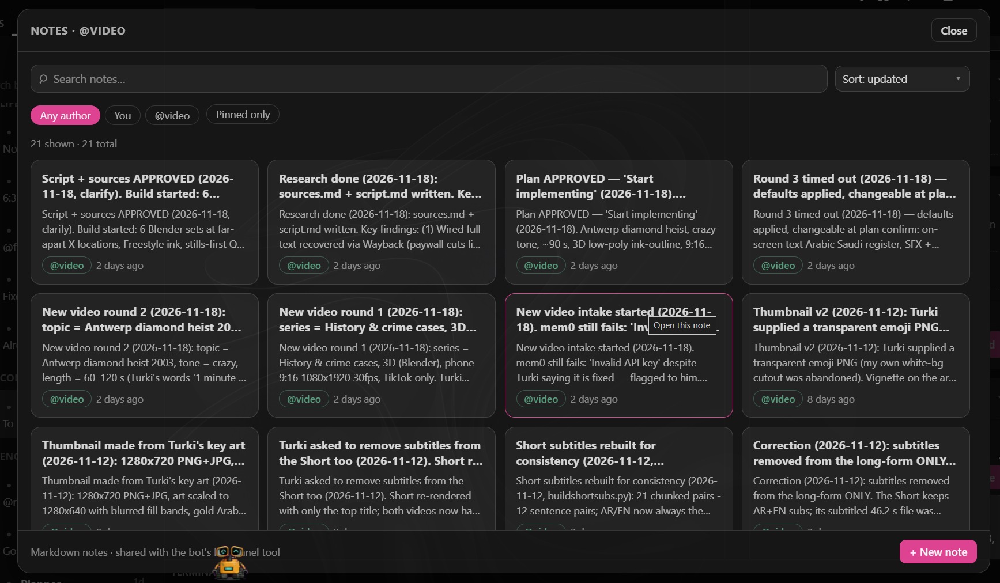
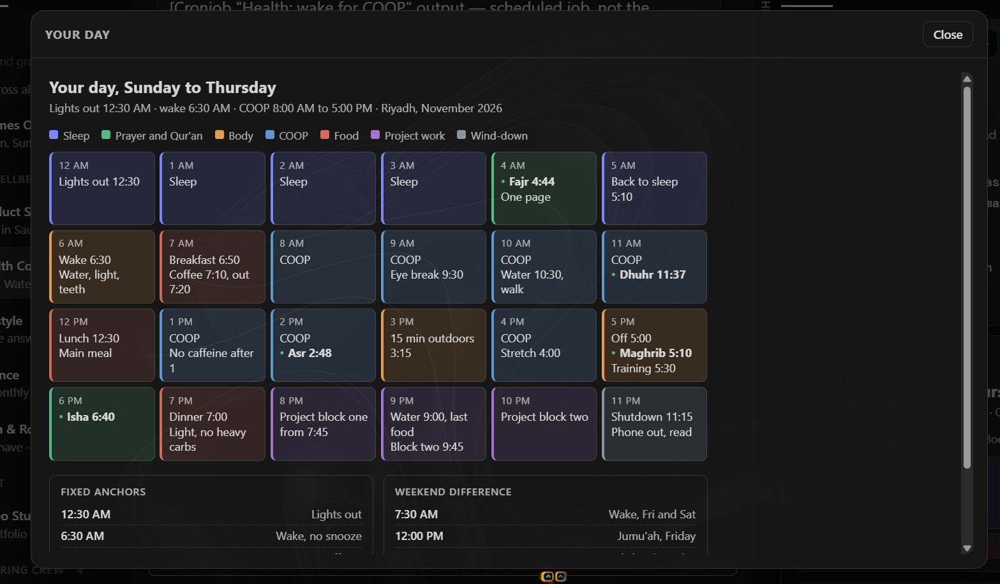
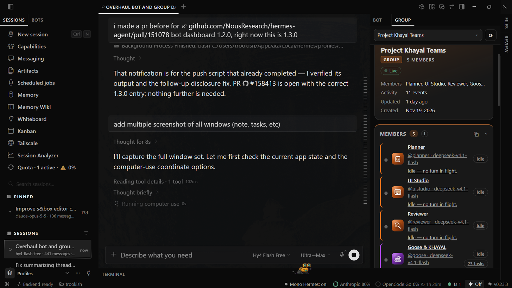
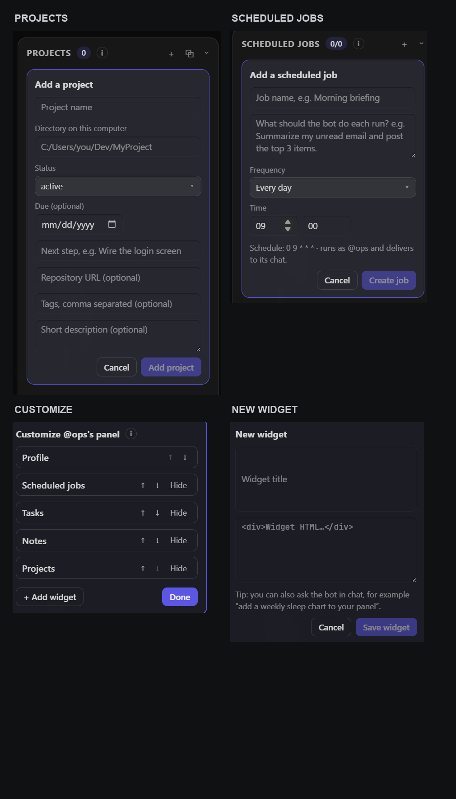

# catalog: add bot-dashboard 1.3.0

Re-pin of [bot-dashboard](https://github.com/trookish/hermes-bot-dashboard) after the
1.3.0 presentation and polish release. This is a new entry pin, following the
same pattern as the merged 1.2.0 PR (#151078).

## What does this PR do?

Adds a catalog entry for **bot-dashboard 1.3.0**, a desktop plugin that puts two
panes beside the chat:

- **Bot** — follows the focused bot: profile and model, scheduled jobs, tasks,
  notes, projects, and the custom HTML widgets that bot pinned for you.
- **Group** — a group chat's dashboard: members and their state, recent activity,
  tasks and projects owned by any member, shared notes and widgets. It follows
  the group chat you have open.

### Screenshots

**Bot pane**

**Tasks window**

**Notes window**

**Your Day** — a custom HTML widget pinned to a panel:

**Group dashboard**

**Projects, scheduled jobs, customize and new widget** panels:

The gallery is also rendered on the plugin's page in the docs site from the
catalog entry's `screenshots` field. All images are committed under `assets/`
in the pinned commit.

## What changed since 1.2.0

- **Brand assets.** Original monochrome banner and icon, generated for this
  plugin and committed under `assets/`. The catalog entry uses the banner as
  its `image` and six screenshots as its gallery, so the plugin's page in
  the docs site and marketplace shows the artwork. `readme: true` renders the
  README there too.
- **Less clutter.** Settings, customize and refresh share one aligned toolbar.
  Long task and note lists open in their own windows; the notes editor behaves
  like a markdown file with read and write modes.
- **Configurable.** Each dashboard's settings window controls appearance,
  refresh behaviour and card counts; the global settings route is editable
  from the same window. Native selects follow the desktop theme.
- **Agent tools.** `bot_panel` gained read/edit actions for tasks, notes,
  projects, settings and session todos; an in-process bridge keeps it and the
  REST routes on the same validation and storage code.
- **Compatibility fixes.** Task statuses, note length and group activity
  errors reported from the live app are fixed; profile-local copies stay in
  sync with the installed plugin.

## Entry details

- `plugin-catalog/bot-dashboard.yaml` — name `bot-dashboard`, tier `community`,
  category `desktop`, version `"1.3.0"`, `requires_hermes: ">=0.20.0"`, pinned
  at `53adac1a302a7d8241600408fefa9307731f4ba8` (the code commit carrying
  1.3.0).
- `image` and `screenshots` point to raw URLs pinned to that same commit, so
  they are immutable with the pin. `readme: true` is set.

## Disclosure (admission rule 13)

- **Reads:** the local Hermes home (bot profiles, `config.yaml`, group room
  records) and, only if the user sets `vault_path`, markdown notes in that
  folder.
- **Writes:** each bot's own panel files (widgets, notes, layout) under its
  profile; when the user creates or ticks a task, that task's note in the
  configured vault folder; and the `group` pane preference in plugin storage.
- **Per-turn context:** a first-turn panel snapshot; an extra per-turn line
  only if the user writes a `panel_rule`.
- **Network:** none. The panes talk to the Hermes API on `127.0.0.1` through
  the plugin host. No third-party calls, no shell commands, no telemetry, no
  stored credentials.

## Verification

- `hermes plugins validate .` — validation passed (tools, hooks, middleware,
  no collisions, safe security scan, no core override, SDK surface only).
- `tests/test_robustness.py` — 73/73 passed.
- `tests/test_tools.py` — 11/11 passed.
- `scripts/validate_plugin_catalog.py` — `OK: 1 file(s) valid`.
- SSR suite 20/20 and client/jsdom suite 34/34 (from the 1.3.0 work).

## Related Issue

N/A — update to the community entry added in #151078.

## Type of Change

- [x] ✨ New feature (non-breaking change that adds functionality)

## Checklist

- [ ] The pinned commit is pushed and public in `trookish/hermes-bot-dashboard`.
- [x] Declared capabilities match registrations at the pin.
- [x] No core modules patched or overridden; plugin SDK only.
- [x] Brand assets and screenshots are original and pinned to the code commit.
